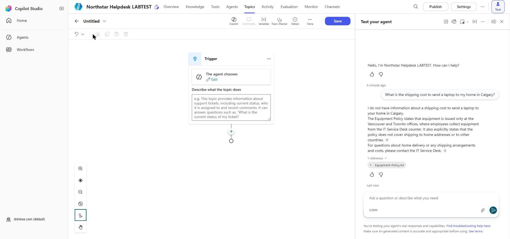
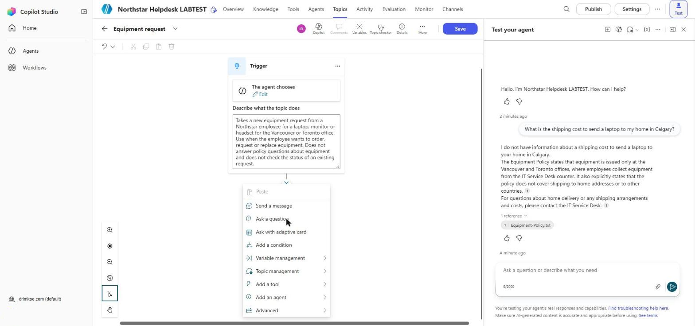
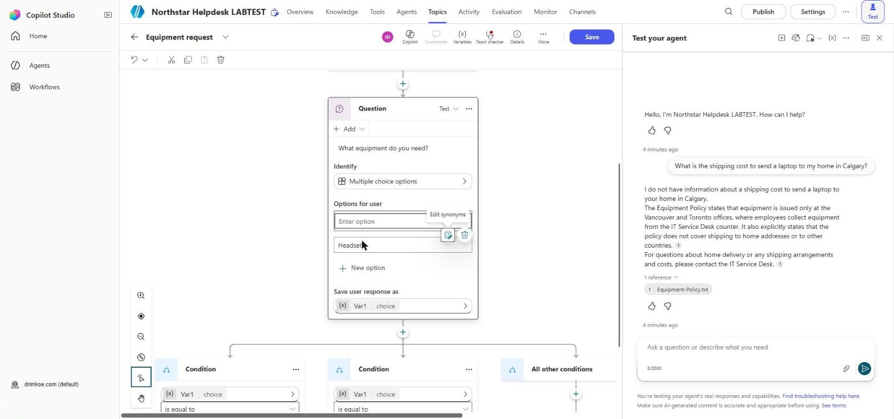
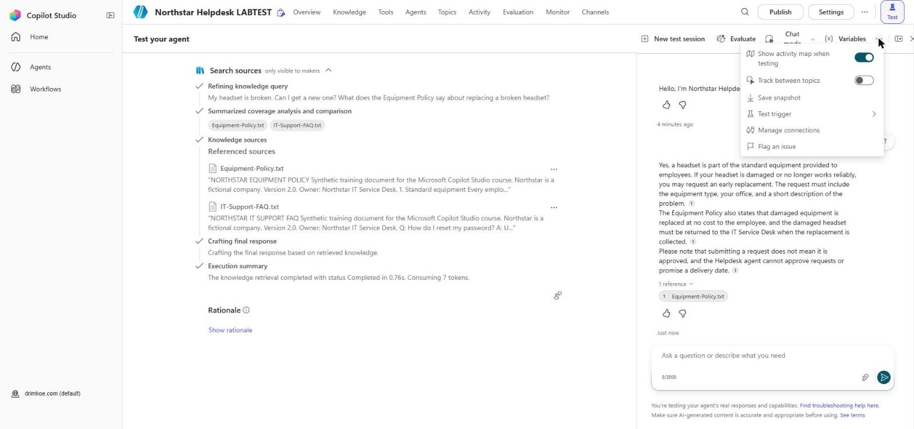
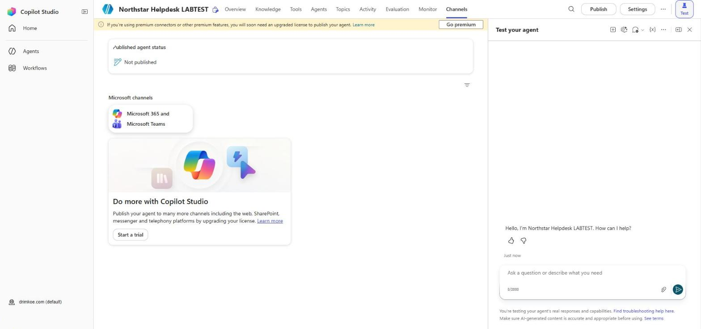

# Lab 3 – Build the Equipment Request Conversation

In this lab you add a designed conversation to the Northstar Helpdesk agent: the **Equipment request** topic. It asks the employee which item they need, which office they are in and why, shows a summary, and asks them to confirm. If they say yes, the agent says the request is ready to submit. If they say no, it confirms that nothing was submitted. You then test the topic, publish the agent, and open it in Microsoft Teams.

The topic does not create a record yet. You connect it to an agent flow in Lab 5.

## Learning Objectives

By the end of this lab you will be able to:

- Create a topic from blank and write a description that generative orchestration can use
- Add Question, Message and Condition nodes and name their variables
- Insert variables into messages
- Design a confirmation with separate Yes and No endings
- Follow a conversation through the canvas and the activity map in the test pane
- Publish the agent and open it in Teams

## Time Required

Roughly **75 minutes**.

## Prerequisites

- The **Northstar Helpdesk** agent from Labs 1 and 2
- Generative orchestration set to **Yes** (Settings → Generative AI)

## The Conversation You Will Build

```
Trigger (The agent chooses)
 └─ Question: What equipment do you need?     → Topic.EquipmentType  (Laptop / Monitor / Headset)
 └─ Question: Which office are you in?        → Topic.Office         (Vancouver / Toronto)
 └─ Question: Briefly, why do you need it?    → Topic.RequestReason  (free text)
 └─ Message:  summary of the three values
 └─ Question: Do you want to submit this request? → Topic.ConfirmSubmit (Yes / No)
 └─ Condition
     ├─ Yes → Message: "Your request is ready to submit..."   → End current topic
     └─ No  → Message: "I have not submitted your request."    → End current topic
```

---

## Part 1: Create the Topic

### Step 1.1 – Add a topic from blank

1. Open your **Northstar Helpdesk** agent.
2. Select the **Topics** tab. Use the **All**, **Custom** and **System** buttons to see the topics the agent already has. The custom ones are **Goodbye**, **Greeting**, **Start Over** and **Thank you**.
3. Select **Add a topic**, then **From blank**. (The other choice, **Add from description with Copilot**, drafts a topic for you. We build this one by hand.)
4. The authoring canvas opens with a **Trigger** node.

**Expected result:** A new topic called **Untitled** with one Trigger node that reads **The agent chooses**, and a **Describe what the topic does** box.



> If the Trigger node reads **User says a phrase**, your agent is using classic orchestration. Go to **Settings → Generative AI**, set orchestration to **Yes**, save, and come back (Lab 1, Step 3.5).

The toolbar above the canvas has **Copilot**, **Comments**, **Variables**, **Topic checker**, **Details**, **More** and **Save**. You will use **Variables** and **Topic checker** later in this lab.

### Step 1.2 – Name and describe the topic

1. At the top left of the canvas, select the topic name (it shows **Untitled**) and type `Equipment request`. You can also change the name in **Details** on the toolbar.
2. On the **Trigger** node, select the **Describe what the topic does** box.
3. Type:

   ```
   Takes a new equipment request from a Northstar employee for a laptop, monitor or headset for the Vancouver or Toronto office. Use when the employee wants to order, request or replace equipment. Does not answer policy questions about equipment and does not check the status of an existing request.
   ```

4. Select **Save** (top right).

**Expected result:** The topic is saved as **Equipment request** with the description above.

> **Why the description is written this way:** the orchestrator uses it to decide when to run this topic. The last sentence stops the topic being chosen for questions like "Is a headset standard equipment?", which should be answered from the policy.

---

## Part 2: Ask for the Equipment

### Step 2.1 – Add the first question

1. Under the Trigger node, select **+** (Add node). The menu lists **Send a message**, **Ask a question**, **Ask with adaptive card**, **Add a condition**, **Variable management**, **Topic management**, **Add a tool**, **Add an agent** and **Advanced**. Select **Ask a question**.
2. In the question text box (**Enter a message**), type: `What equipment do you need?`
3. Under **Identify**, leave **Multiple choice options** selected. It is the default.
4. Under **Options for user**, select **+ New option** three times and enter:
   - `Laptop`
   - `Monitor`
   - `Headset`

   Each option has an **Edit synonyms** button. You will use entities with synonyms in Lab 4, so leave it for now.
5. Under **Save user response as**, select the variable (it shows **Var1** **choice**). In the **Variable properties** pane, change the name to `EquipmentType`, then close the pane.

**Expected result:** A Question node with three options and a variable named **EquipmentType**. Copilot Studio adds a **Condition** branch for each option and an **All other conditions** branch below the node.





### Step 2.2 – Join the branches

Copilot Studio adds a branch for each option. We want all three to continue to the same next question, so the branches are not needed.

1. On each **Condition** branch and on **All other conditions**, select **…** → **Delete**.
2. Check that the Question node now has a single **+** below it. The question still saves the answer in `EquipmentType`.

**Expected result:** The conversation continues from the question to a single next step, regardless of the option chosen.

---

## Part 3: Ask for the Office and the Reason

### Step 3.1 – Office question

1. Below the equipment question, select **+** → **Ask a question**.
2. Question text: `Which office are you in?`
3. **Identify**: **Multiple choice options**.
4. Options: `Vancouver`, `Toronto`.
5. Rename the variable to `Office`.
6. Delete the option branches, as in Step 2.2.

### Step 3.2 – Reason question

1. Below the office question, select **+** → **Ask a question**.
2. Question text: `Briefly, why do you need it? For example, "my screen flickers" or "I'm starting a new role".`
3. **Identify**: **User's entire response**.
4. Rename the variable to `RequestReason`.

### Step 3.3 – Save

Select **Save**.

**Expected result:** Three Question nodes, saving `EquipmentType`, `Office` and `RequestReason`.

---

## Part 4: Summary and Confirmation

### Step 4.1 – Summary message

1. Below the reason question, select **+** → **Send a message**.
2. Type `Here is your request:` then press **Shift+Enter** for a new line.
3. Type `- Equipment: ` then select the **{x}** (Insert variable) icon and choose **EquipmentType**.
4. New line: `- Office: ` then insert **Office**.
5. New line: `- Reason: ` then insert **RequestReason**.

**Expected result:** The message shows the three variables as colored tokens, not as typed text.

> If a variable name appears as plain text (for example `{Topic.Office}` in black), it was typed rather than inserted. Delete it and insert it with the **{x}** icon.

### Step 4.2 – Confirmation question

1. Below the message, select **+** → **Ask a question**.
2. Question text: `Do you want to submit this request?`
3. **Identify**: **Boolean**.
4. Rename the variable to `ConfirmSubmit`.

### Step 4.3 – Condition

1. Below the confirmation question, select **+** → **Add a condition**.
2. In the left branch (**Condition**), select **Select a variable** → **ConfirmSubmit**, operator **is equal to**, value **true** (Yes).
3. The right branch is **All other conditions**. This is the No path.

**Expected result:** A Condition node with a Yes branch and an All other conditions branch.

---

## Part 5: The Two Endings

### Step 5.1 – Yes branch

1. In the **Condition** (Yes) branch, select **+** → **Send a message**:

   ```
   Thank you. Your request is ready to submit. Request submission will be connected in a later lab, so no request has been created yet.
   ```

2. Below it, select **+** → **Topic management** → **End current topic**.

### Step 5.2 – No branch

1. In the **All other conditions** branch, select **+** → **Send a message**:

   ```
   No problem. I have not submitted your request. You can start again at any time.
   ```

2. Below it, select **+** → **Topic management** → **End current topic**.

### Step 5.3 – Save and check

1. Select **Save**.
2. Check the canvas from top to bottom. Make sure:
   - no message claims a request ID or approval;
   - the No branch cannot reach the Yes message.

**Expected result:** A complete topic with two separate endings.

---

## Part 6: Test in the Test Pane

### Step 6.1 – Happy path

1. Select **Test**, then **New test session**.
2. Open the **…** menu at the top of the pane. **Show activity map when testing** is on by default. Turn **Track between topics** on as well.


3. Type: `I need to order a new monitor`
4. Answer the questions: choose **Toronto**, type `My screen flickers`, and answer **Yes**.

**Expected result:**
- The activity map shows the **Equipment request** topic was chosen.
- The canvas highlights each node with a checkmark as it runs.
- The summary shows Monitor, Toronto and your reason.
- The Yes message appears and says no request has been created yet.

> With generative orchestration the agent may skip the equipment question because you already said "monitor". That is slot filling, which you look at properly in Lab 4.

### Step 6.2 – Cancel path

1. Select **New test session**.
2. Type: `Can I request a headset?`
3. Choose **Vancouver**, type a reason, and answer **No**.

**Expected result:** The No message appears. Nothing claims the request was submitted.

### Step 6.3 – Routing checks

Select **New test session** before each message. Record which topic or knowledge source handled it (use the activity map).

| Message | Expected handler | Actual |
|---|---|---|
| `Is a headset standard equipment?` | Knowledge (Equipment Policy) | |
| `My laptop is broken, I need a replacement` | Equipment request topic | |
| `What are the service desk hours?` | Knowledge (IT Support FAQ) | |
| `I want a new screen` | Equipment request topic | |

**Expected result:** Policy questions are answered from knowledge; requests start the topic.

If a policy question starts the topic, make the last sentence of the topic description more specific and test again.

---

## Part 7: Publish and Open the Agent

### Step 7.1 – Publish

1. Select **Publish** (top right), then **Publish** again to confirm.
2. Wait for the confirmation message. Publishing can take a few minutes.

**Expected result:** A message says the agent was published.

### Step 7.2 – Open in Teams

1. Select the **Channels** tab.
2. Under **Microsoft channels**, select **Microsoft 365 and Microsoft Teams**.
3. Select **Add channel** if it is not already added, then select the option to open the agent in Teams (the label may be **See agent in Teams** or **Open the agent in Teams**).
4. In Teams, select **Add** to install the agent for yourself.
5. Send: `I need a new headset` and complete the request with **No** at the end.

**Expected result:** The agent runs the Equipment request topic in Teams.



> If Teams says the app is blocked, your tenant's Teams admin settings do not allow custom apps. Note it and continue.

### Step 7.3 – Other channels (discussion)

Look at the rest of the **Channels** tab. In a trial or a tenant without the full license, a banner says other channels need a license, and only **Microsoft 365 and Microsoft Teams** can be used.

Channels such as the demo website and a custom website also depend on the authentication setting. With **Authenticate with Microsoft**, the agent can only be used in Microsoft channels such as Teams. You look at the authentication options in Lab 4.

**Expected result:** You can explain why the Northstar agent is published to Teams only.

---

## Completion Checklist

- [ ] Topic **Equipment request** with the description from Step 1.2
- [ ] Variables `EquipmentType`, `Office`, `RequestReason`, `ConfirmSubmit`
- [ ] Summary message uses inserted variables
- [ ] Yes and No endings; no message claims a request ID
- [ ] Happy path and cancel path tested
- [ ] Routing table completed; policy questions go to knowledge
- [ ] Agent published and opened in Teams (or the blocker recorded)
- [ ] Authentication set to **Authenticate with Microsoft**

## Troubleshooting

- **The topic never runs; the agent answers from knowledge instead** – the description is too vague or too close to the knowledge description. Rewrite the first sentence so it clearly says "takes a new equipment request", save, select **New test session** and test again.
- **The topic runs for policy questions** – add the "does not answer policy questions" sentence to the description.
- **A variable shows as text in the message** – insert it with the **{x}** icon rather than typing it.
- **The conversation stops after the equipment question** – one of the option branches is still on the canvas and the next node was added inside it. Delete the option branches (Step 2.2) and check there is one path from top to bottom.
- **The Teams change is not visible** – published changes appear in new sessions. In Teams, type `start over`.
- **Other channels are grayed out** – your tenant does not have the license for them, or the agent uses **Authenticate with Microsoft**. See Step 7.3.
