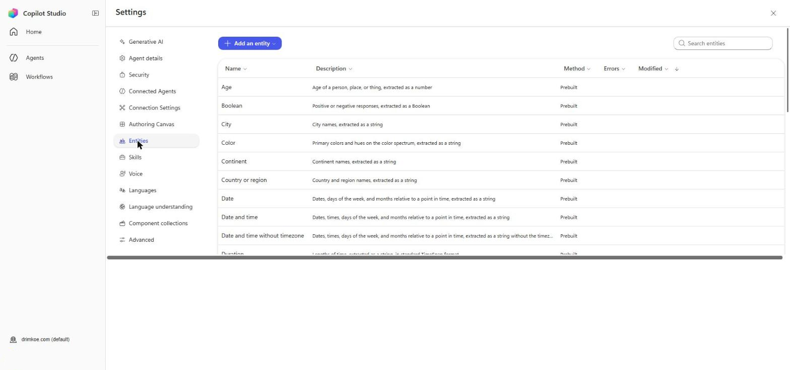
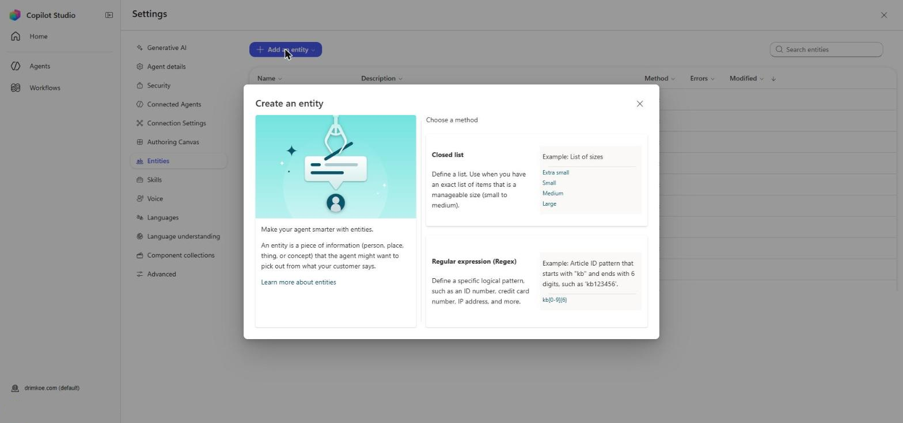
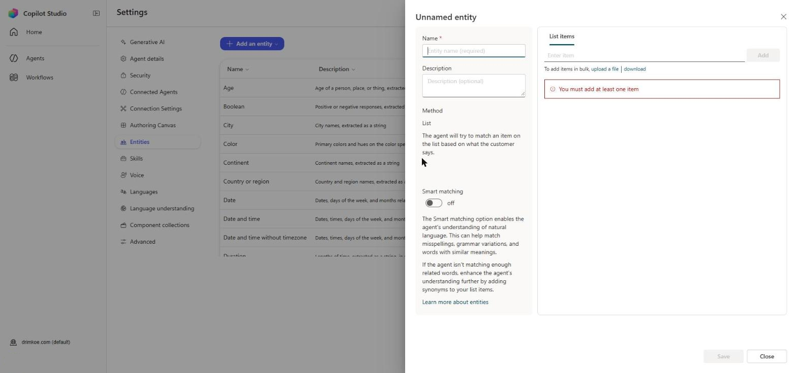
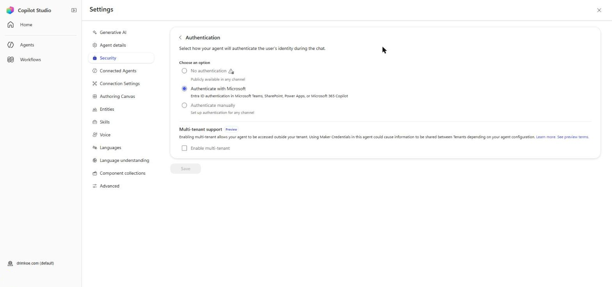

# Lab 4 – Variables, Entities and Authentication

In this lab you make the Equipment request conversation easier to use. You create an entity so the agent understands "screen" and "notebook", make the office a global variable so it is asked only once per conversation, build the summary with a Power Fx formula, greet the employee by name, and check how the agent's authentication setting affects what it knows about the user.

## Learning Objectives

By the end of this lab you will be able to:

- Create a closed-list entity with synonyms and Smart matching
- Use a custom entity in a Question node and observe slot filling
- Change a variable to global scope and reuse it across topics
- Write a Power Fx formula in a Set a variable value node
- Use the `User.DisplayName` system variable
- Explain what the authentication setting changes

## Time Required

Roughly **75 minutes**.

## Prerequisites

- The **Northstar Helpdesk** agent with the **Equipment request** topic from Lab 3
- Authentication set to **Authenticate with Microsoft** (Settings → Security → Authentication)

---

## Part 1: Create the Equipment Type Entity

### Step 1.1 – Open the entities list

1. Open your agent and select **Settings** (top right).
2. In the Settings menu on the left, select **Entities**.

**Expected result:** A list of prebuilt entities such as **Age**, **Boolean**, **City**, **Color**, **Country or region** and **Date and time**.



### Step 1.2 – Create a closed list

1. Select **Add an entity**, then **New entity**. (The other choice, **Register an external entity**, is for entities defined outside Copilot Studio.)
2. In **Create an entity**, select **Closed list**.

   

3. The entity panel opens. In **Name**, type `Equipment type`.
4. In **Description**, type `The standard equipment an employee can request: laptop, monitor or headset.`
5. On the **List items** tab, type each item in **Enter item** and select **Add**. Then add its synonyms:

   | Item | Synonyms |
   |---|---|
   | Laptop | notebook |
   | Monitor | screen, display |
   | Headset | headphones, earphones |

   Synonyms are added on each item after you add it. Type each word and press Enter after each.
6. Turn **Smart matching** on. The panel explains that it helps match misspellings, grammar variations and words with similar meanings.
7. Select **Save** at the bottom of the panel.



**Expected result:** The **Equipment type** entity appears in the custom entities list.

> The synonyms come from the IT Support FAQ ("screen and display mean Monitor"). Keeping the entity and the documents consistent matters: if the service desk adds a new word to the FAQ, add it here too.

---

## Part 2: Use the Entity in the Equipment Question

### Step 2.1 – Change what the question identifies

1. Close **Settings** with the **X** at the top right. Select **Topics** and open **Equipment request**.
2. Select the **What equipment do you need?** Question node.
3. Under **Identify**, change **Multiple choice options** to **Equipment type** (listed under custom entities).
4. If the node offers **Select options for user**, turn it on and tick all three items, so buttons are still shown.
5. Check that the variable is still named `EquipmentType`. Its type is now **Equipment type**.
6. If the old option branches are still on the canvas, delete them.
7. Select **Save**.

**Expected result:** The question identifies the **Equipment type** entity and still shows three buttons.

### Step 2.2 – Test synonyms and misspellings

Select **Test**, then **New test session** before each message. Complete each request with **No** at the confirmation so nothing is prepared.

| Message | Expected EquipmentType |
|---|---|
| `I need a new screen` | Monitor |
| `Can I order a notebook?` | Laptop |
| `my headphones broke` | Headset |
| `I need a new moniter` (misspelt) | Monitor (Smart matching) |

To see the value, open **Variables** on the topic toolbar and select the **Test** tab while the conversation runs.

**Expected result:** All four are recognized, and the equipment question is skipped because the answer was already in the message. This is slot filling.

### Step 2.3 – Force the question once (optional)

1. Select the equipment Question node → **…** → **Properties** → **Question behavior**.
2. Under **Skip question**, select **Ask every time**. Save and test `I need a new screen`.
3. Notice the agent now asks even though you said "screen".
4. Set **Skip question** back to its default and save.

---

## Part 3: Make the Office Global

### Step 3.1 – Change the scope

1. In **Equipment request**, select the **Which office are you in?** Question node.
2. Select the **Office** variable to open **Variable properties**.
3. Change the scope (the **Usage** / **Global** option) so the variable is **Global (any topic can access)**.
4. Confirm the warning that this cannot be undone.
5. Select **Save**.

**Expected result:** The variable is now named `Global.Office`, and the summary message still shows it.

> If the summary formula from Lab 3 now shows a red error underline, open it and change `Topic.Office` to `Global.Office`.

### Step 3.2 – Ask only when unknown

The office question should be skipped if `Global.Office` already has a value.

1. Select the office Question node → **…** → **Properties** → **Question behavior**.
2. Under **Skip question**, make sure it is set to **Allow question to be skipped** (the default). A global variable that already has a value counts as answered.
3. Save.

### Step 3.3 – Test two requests in one conversation

1. Select **New test session**.
2. Send `I need a new monitor`. Answer **Toronto**, give a reason, answer **No**.
3. Without resetting, send `I also need a headset`.

**Expected result:** The second request does not ask for the office. The summary shows Toronto.

---

## Part 4: Build the Summary with Power Fx

### Step 4.1 – Create a summary variable

1. In **Equipment request**, select **+** between the reason question and the summary message.
2. Select **Variable management** → **Set a variable value**.
3. Under **Set variable**, select **Create new** and name it `RequestSummary`.
4. In **To value**, select the **…** / **Formula** option to open the Power Fx editor and enter:

   ```
   Concatenate(Text(Topic.EquipmentType), " for the ", Text(Global.Office), " office – ", Topic.RequestReason)
   ```

5. Select **Insert** (or **Done**), then **Save**.

**Expected result:** The node shows no red error underline.

> `Text()` converts the entity and choice values to plain text. You will need the same conversion when you pass it to the agent flow in Lab 5.

### Step 4.2 – Use it in the message

1. Edit the summary message. Delete the formula from Lab 3 and replace it with:

   `Here is your request: ` followed by the **RequestSummary** variable, inserted with **{x}**.

2. Save and test one request.

**Expected result:** The summary reads, for example: "Here is your request: Monitor for the Toronto office – my screen flickers".

---

## Part 5: Greet the Employee by Name

### Step 5.1 – Edit Conversation Start

1. Select **Topics**, then the **System** tab.
2. Open **Conversation Start**.
3. Edit the first Message node. Replace the greeting with:

   `Hello ` + **User.DisplayName** (insert with **{x}**, **System** tab) + `. I'm Northstar Helpdesk. I can answer questions about IT equipment and support, and help you request a laptop, monitor or headset.`

4. Save.

### Step 5.2 – Test

1. In the test pane, select **New test session**.

**Expected result:** The greeting shows your training account's display name.

> In the test pane you are signed in as yourself. In Teams, the name comes from the employee's Microsoft Entra ID account. With **No authentication**, `User.DisplayName` would be empty.

---

## Part 6: Authentication Review

### Step 6.1 – Look at the options

1. Select **Settings** → **Security**, then the **Authentication** card.
2. Read the three options. **Do not change the setting.** Fill in the table.
   - In many company tenants **No authentication** and **Authenticate manually** are grayed out, because an administrator has restricted them. Read their descriptions anyway.
   - You may also see a **Multi-tenant (preview)** option. Leave it off.



| Option | Who can chat? | Is User.DisplayName available? | Which channels? |
|---|---|---|---|
| No authentication | | | |
| Authenticate with Microsoft | | | |
| Authenticate manually | | | |

### Step 6.2 – Answer

In one sentence each:

1. Why is **Authenticate with Microsoft** the right choice for an internal Northstar agent used in Teams?
2. In Lab 5 the flow records who made the request. Why is it better to take the requester from the signed-in user than to ask them to type an email address?

**Expected result:** Your table and answers match the Module 4 slides. Your instructor will check them in the debrief.

---

## Part 7: Conversation History and Reset

1. In the test pane, send `I need a new laptop`, choose Vancouver, give a reason, answer **No**.
2. Send `start over` (this runs the **Start Over** topic, which goes to the **Reset Conversation** system topic).
3. Send `I need a headset`.

**Expected result:** The office is asked again, because **Reset Conversation** clears global variables.

---

## Part 8: Regression Check

Rerun the Lab 3 routing table (Lab 3, Step 6.3) and the happy and cancel paths.

**Expected result:** Everything that passed in Lab 3 still passes. Then **Publish** the agent.

---

## Completion Checklist

- [ ] **Equipment type** entity with synonyms and Smart matching
- [ ] Equipment question identifies the entity; synonyms and a misspelling recognized
- [ ] `Global.Office` asked once across two requests
- [ ] `RequestSummary` built with Power Fx and shown in the summary
- [ ] Greeting uses `User.DisplayName`
- [ ] Authentication table and two answers completed; setting unchanged
- [ ] `start over` clears the office
- [ ] Lab 3 tests rerun and passing; agent published

## Troubleshooting

- **The entity is not listed under Identify** – it was not saved, or you are editing a different agent. Check **Settings → Entities**.
- **"screen" is not recognized** – check the synonym is on the **Monitor** item, not added as a separate item. Save the entity and select **New test session** in the test pane.
- **The formula shows an error** – check the quotes are straight double quotes, the variable names include `Topic.` or `Global.`, and the entity value is wrapped in `Text()`.
- **The office is still asked on the second request** – the variable is still topic-scoped, or you selected **New test session** between the requests.
- **The greeting shows no name** – authentication is set to **No authentication**. Set it back to **Authenticate with Microsoft** and publish.
