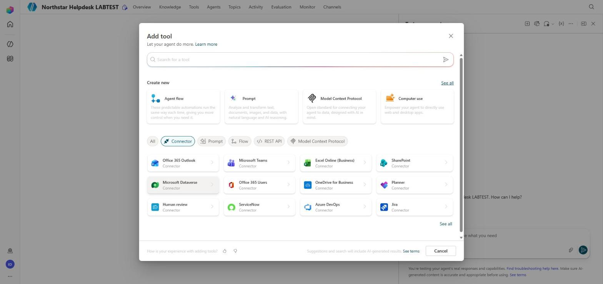
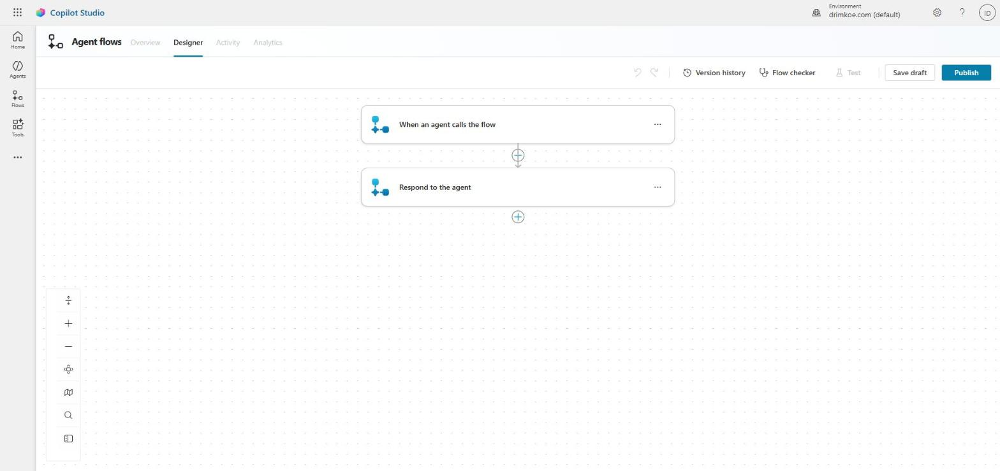
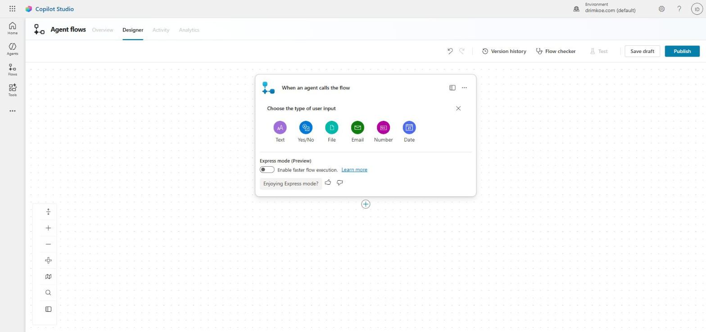
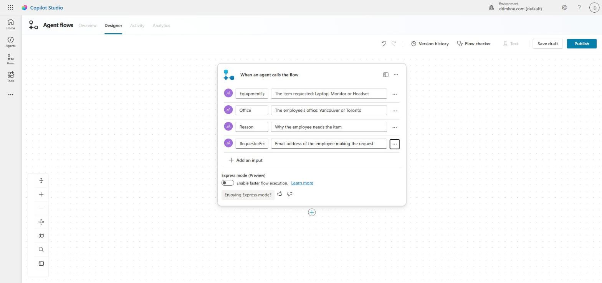

# Lab 5 – Extend the Agent with an Automated Workflow

In this lab the Northstar Helpdesk agent starts doing real work. You build an agent flow called **Create equipment request**. It creates an item in the **EquipmentRequests** SharePoint list, emails the requester, and returns the new item's ID and a status to the agent. You then call the flow from the Yes branch of the Equipment request topic, so a confirmed request produces a real record and a real request ID.

## Learning Objectives

By the end of this lab you will be able to:

- Create an agent flow with the **When an agent calls the flow** trigger and typed inputs
- Add SharePoint **Create item** and Office 365 Outlook **Send an email (V2)** actions
- Return outputs with **Respond to the agent**
- Handle a failure so the agent never reports success that did not happen
- Call the flow from a topic with a Tool node and map variables to its inputs
- Test end to end and read the flow's run history

## Time Required

Roughly **90 minutes**.

## Prerequisites

- The **Northstar Helpdesk** agent with the Lab 4 changes (Equipment type entity, `Global.Office`, `RequestSummary`)
- The URL of the training SharePoint site, from your instructor, for example `https://northstartraining.sharepoint.com/sites/ITServiceDesk`
- A list named **EquipmentRequests** on that site. Your instructor has created it (see `Lab Materials/List-Schema.md`). If you use your own tenant, create it yourself from that file first.

### Before you start – check the list

1. Open the SharePoint site in a new browser tab.
2. Open **EquipmentRequests**.
3. Select **+ New**, create a test item (Title `Test`, EquipmentType **Monitor**, Office **Toronto**, RequestReason `test`), and save it.
4. Delete the test item.

**Expected result:** You can create and delete items. If you cannot, tell the instructor now; the flow will fail with the same permission error.

---

## Part 1: Create the Agent Flow

### Step 1.1 – Start from the agent's Tools page

1. Open your agent and select the **Tools** tab. A new agent shows **Create your first tool**.
2. Select **Add a tool**. The **Add tool** dialog opens.
   - Under **Create new** it offers **Agent flow**, **Prompt**, **Model Context Protocol** and **Computer use**.
   - Below that are filters (**All**, **Connector**, **Prompt**, **Flow**, **REST API**, **Model Context Protocol**) and a list of connectors such as **Office 365 Outlook**, **SharePoint** and **Microsoft Teams**.
3. Under **Create new**, select **Agent flow**.



### Step 1.2 – Open the designer

1. Copilot Studio shows **This page opens in the classic experience**. Select **Open in a new tab**.
2. A new browser tab opens. It can take up to a minute to load.
   - The first time you open the classic experience, a **Welcome to Microsoft Copilot Studio** dialog may appear. Select **Get Started**, and skip the tour if one starts.
3. The **Designer** tab of the flow opens with two steps already in place:
   - **When an agent calls the flow** (trigger)
   - **Respond to the agent** (response)

**Expected result:** The designer shows the trigger and the response action. The toolbar has **Version history**, **Flow checker**, **Test**, **Save draft** and **Publish**. **Test** stays grayed out until the flow has been saved.

Keep the agent's tab open. You return to it in Part 6.



> If the designer opens with **Add a trigger** instead, type `When an agent calls` in the search box and scroll down to the **Skills** group. Select **When an agent calls the flow**. Add **Respond to the agent** yourself in Part 4.

### Step 1.3 – Add the inputs

1. Select the **When an agent calls the flow** trigger. It expands to show **Add an input** and an **Express mode (Preview)** toggle. Leave Express mode off.
2. Select **Add an input**. Choose the type of input: **Text**, **Yes/No**, **File**, **Email**, **Number** or **Date**. Select **Text**.
3. A new row appears with a name box (it shows **Text**) and a description box (**Please enter your input**). Replace both.
4. Repeat until you have four Text inputs:

   | Type | Name | Description |
   |---|---|---|
   | Text | EquipmentType | The item requested: Laptop, Monitor or Headset |
   | Text | Office | The employee's office: Vancouver or Toronto |
   | Text | Reason | Why the employee needs the item |
   | Text | RequesterEmail | Email address of the employee making the request |

**Expected result:** The trigger shows four Text inputs with descriptions.





> The **Email** input type would also work for RequesterEmail. We use Text so every input is mapped the same way in Part 6.

### Step 1.4 – Save a draft and name the flow

1. Select **Save draft**.
2. Select the **Overview** tab of the flow. Change the name to `Create equipment request` and save. If Copilot Studio asks for a name when you first save, type it there instead.
3. Return to the **Designer** tab.

---

## Part 2: Create the SharePoint Item

### Step 2.1 – Add Create item

1. Select the **+** between the trigger and **Respond to the agent**. The **Add an action** panel opens.
2. In **Search for an action or connector**, type `Create item` and select **Create item** under **SharePoint**.
3. If asked to sign in, sign in with your training account to create the connection.
4. Set:
   - **Site Address**: select the training site, or choose **Enter custom value** and paste the site URL.
   - **List Name**: **EquipmentRequests**
5. Fill the fields. Click in each box and use the **dynamic content** (lightning) icon to pick trigger inputs:

   | Field | Value |
   |---|---|
   | Title | Type `Request from ` then add **RequesterEmail** |
   | EquipmentType Value | **EquipmentType** (trigger input) |
   | Office Value | **Office** (trigger input) |
   | RequestReason | **Reason** (trigger input) |
   | Status Value | Type `Submitted` |

**Expected result:** Create item has every required field filled.

> The choice columns expect exactly `Laptop`, `Monitor`, `Headset`, `Vancouver`, `Toronto` and `Submitted`. A different spelling fails the step.

---

## Part 3: Email the Requester

### Step 3.1 – Add Send an email (V2)

1. Select the **+** after **Create item**.
2. In the **Add an action** panel, search for `Send an email (V2)` and select it (Office 365 Outlook). Sign in if asked.
3. Set:
   - **To**: **RequesterEmail** (trigger input)
   - **Subject**: `Your equipment request NS-` then add **ID** from **Create item**
   - **Body**:

     ```
     Hello,

     We have received your equipment request.

     Request ID: NS-[ID]
     Equipment: [EquipmentType]
     Office: [Office]
     Reason: [Reason]

     The IT Service Desk will review it and email you when the item is ready for collection. Submitting a request does not mean it is approved.

     Northstar IT Service Desk
     ```

     Replace each `[ ]` with the matching dynamic content: **ID** from **Create item**, and the trigger inputs.

**Expected result:** The email action is filled in with dynamic content, not typed placeholders.

---

## Part 4: Return the Result

### Step 4.1 – Add outputs to Respond to the agent

1. Select **Respond to the agent**.
2. Select **+ Add an output**, **Text**:
   - Name `RequestID`, value: **ID** from **Create item**
3. Select **+ Add an output**, **Text**:
   - Name `Status`, value: type `Submitted`

**Expected result:** Two outputs, RequestID and Status.

### Step 4.2 – Handle failure

If **Create item** fails, the agent must say so.

1. Select **+** after **Create item** and add a parallel branch, or add a second **Respond to the agent** action as follows:
   - Add a new **Respond to the agent** step below the email step's failure path. On it, select **…** → **Settings** (or **Configure run after**) and tick **has failed** and **has timed out** for **Create item**; untick **is successful**.
   - Outputs: `RequestID` = `none`, `Status` = `Failed`.

> If your designer makes this awkward, skip Step 4.2 and complete Part 7 Step 7.3 instead, which shows the failure behavior from the topic side.

### Step 4.3 – Save and publish

1. Select **Save draft**, then **Publish** (both on the toolbar at the top right).
2. Wait for the confirmation.

**Expected result:** The flow is published. It appears on the agent's **Tools** tab.

---

## Part 5: Test the Flow on Its Own

1. In the designer toolbar, select **Test**, then **Manually**, then **Test**. (**Test** is available once the flow has been saved.)
2. Enter:
   - EquipmentType `Monitor`
   - Office `Toronto`
   - Reason `Lab 5 test`
   - RequesterEmail: your training account's email address
3. Select **Run flow**.
4. When it finishes, open each step and check the green checkmarks.
5. Open the SharePoint list and find the new item. Open your mailbox (Outlook on the web) and find the email.

**Expected result:** One new list item, one email, and the run history shows RequestID matching the item's ID.

---

## Part 6: Call the Flow from the Topic

### Step 6.1 – Configure the tool

1. Return to the agent's browser tab and refresh it. Select **Tools** and open **Create equipment request**. If it is not listed, select **Add a tool**, select the **Flow** filter, and add it from there.
2. In **Description**, type: `Creates a new Northstar equipment request in the service desk list and emails the requester. Call only after the employee has confirmed the request.`
3. Under **Details**, turn **off** **Allow agent to decide dynamically when to use the tool**. We call this flow only from the topic.
4. Under **Authentication**, leave **Maker-provided** credentials selected (the connections you signed in with).
5. Save.

### Step 6.2 – Add the Tool node

1. Open **Topics** → **Equipment request**.
2. In the **Yes** branch of the Condition, delete the old "ready to submit" message.
3. Select **+** → **Add a tool**, and choose **Create equipment request**.
4. Map the inputs:

   | Flow input | Value |
   |---|---|
   | EquipmentType | Formula: `Text(Topic.EquipmentType)` |
   | Office | `Global.Office` |
   | Reason | `Topic.RequestReason` |
   | RequesterEmail | The signed-in user's email. Use the **User** system variables if your tenant shows an email field; otherwise type your training email for this lab and note it as a known limitation. |

5. The node shows two outputs: **RequestID** and **Status**. Leave their variable names as they are.

### Step 6.3 – Tell the employee the result

1. Below the Tool node, add **+** → **Add a condition**: `Status` **is equal to** `Submitted`.
2. In the matching branch, add a message:

   `Your request NS-` + **RequestID** (insert with **{x}**) + ` has been submitted. You will receive a confirmation email. The IT Service Desk will review it; submitting does not mean it is approved.`

3. In **All other conditions**, add a message:

   `Sorry, I could not submit your request. Nothing has been created. Please contact the IT Service Desk.`

4. End both branches with **End current topic**.
5. Save and **Publish** the agent.

**Expected result:** The Yes branch calls the flow and reports the real ID, or an honest failure.

---

## Part 7: Test End to End

### Step 7.1 – Happy path

1. Select **Test**, then **New test session**.
2. Send `I need a new headset for Vancouver`, give a reason, answer **Yes**.
3. Watch the activity map: the Tool node should run once.

**Expected result:** The agent replies with `NS-` and a number. The list has a matching item and you have received an email.

### Step 7.2 – Cancel path

1. Select **New test session**. Start a request and answer **No**.
2. Check the list.

**Expected result:** No new item.

### Step 7.3 – Controlled failure

1. Open the flow, and in **Create item** temporarily change **Office Value** to the text `Calgary` (not an allowed choice). Save and publish.
2. In the test pane, select **New test session** and complete a request with **Yes**.
3. Open the flow's **Run history** and find the failed run. Open **Create item** and read the error.
4. **Change Office Value back** to the **Office** input, save and publish.

**Expected result:** The agent says it could not submit the request and does not show a request ID. The run history shows the choice-value error.

### Step 7.4 – Record the results

| Test | Expected | Actual | List item? | Email? |
|---|---|---|---|---|
| Happy path | Real NS- ID | | | |
| Cancel | "not submitted" | | | |
| Controlled failure | "could not submit", no ID | | | |

---

## Optional Extension: Notify the Service Desk in Teams

After **Send an email (V2)**, add **Post message in a chat or channel** (Microsoft Teams) to post `New equipment request NS-[ID]: [EquipmentType] for [Office]` to a channel your instructor names.

---

## Completion Checklist

- [ ] Flow **Create equipment request** with four Text inputs
- [ ] **Create item** writes all fields; **Send an email (V2)** uses dynamic content
- [ ] **Respond to the agent** returns RequestID and Status
- [ ] Flow published and tested on its own
- [ ] Tool node in the Yes branch with inputs mapped
- [ ] Success message shows the real ID; failure message shows no ID
- [ ] Happy, cancel and failure tests recorded
- [ ] Office Value restored after the failure test; agent published

## Troubleshooting

- **The flow is not listed when adding the tool** – it is not published, or it was created in another environment. Publish it, refresh the agent's tab, and check the environment picker (top right in the classic tab, bottom left in the new experience).
- **The designer tab stays blank** – the classic experience can take a minute to load. Wait, then refresh the tab. Close other Copilot Studio tabs you are not using.
- **Create item fails with a choice error** – the value does not exactly match the list's choices. Check spelling and capitalization, and that EquipmentType is converted with `Text()`.
- **Create item fails with access denied** – your account cannot add items to the list. Tell the instructor.
- **The agent shows `NS-` with no number** – the message uses an empty variable. Check that the message inserts the Tool node's **RequestID** output.
- **Two items were created** – the flow is also being called dynamically. Turn off **Allow agent to decide dynamically when to use the tool** (Step 6.1).
- **No email arrives** – check the junk folder and the run history for the email step. Training mailboxes can take a few minutes.
