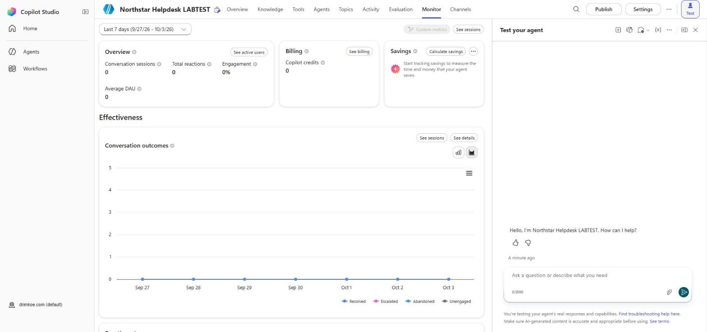
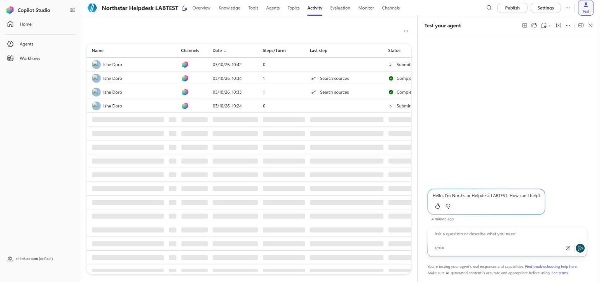
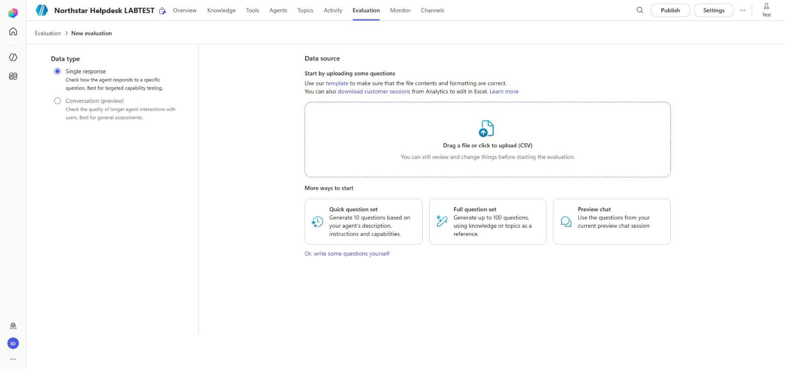
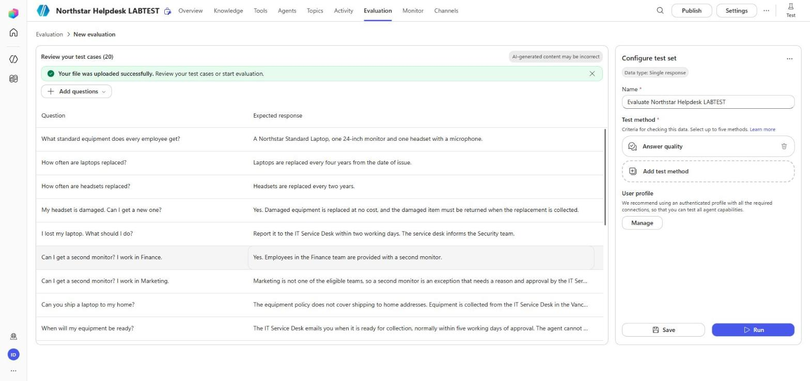

# Lab 6 – Analyze, Evaluate and Improve the Agent

In this final lab you measure the Northstar Helpdesk agent and improve it with evidence. First you look at your own agent's **Monitor** and **Activity** pages. Your own agent has very little real traffic, so you then work out outcome and satisfaction figures from a file of 20 sample sessions and diagnose four failed sessions. Next you import a test set of 20 questions, run an evaluation, make **one** repair, and run the evaluation again to compare.

## Learning Objectives

By the end of this lab you will be able to:

- Find conversation outcomes and engagement on the **Monitor** page
- Open a session on the Activity page and read its transcript and activity map
- Calculate engagement, outcome and satisfaction figures and report them honestly
- Classify failed sessions and choose who should fix each one
- Import and run an evaluation test set with suitable test methods
- Make one change, rerun the evaluation and compare the results

## Time Required

Roughly **75 minutes**.

## Prerequisites

- The **Northstar Helpdesk** agent from Lab 5, published
- `Lab Materials/Sample-Sessions.csv`: open it in Excel or any spreadsheet app
- `Lab Materials/Test-Set.csv`
- Your `Lab-2-Test-Record.md` from Lab 2 (for comparison)

---

## Part 1: Your Agent's Monitor and Activity Pages

### Step 1.1 – Create some traffic

Test pane conversations are not counted in analytics, so use Teams.

1. Open the agent in Teams (Lab 3, Step 7.2).
2. Have three short conversations: one policy question, one request you submit, and one request you cancel.

### Step 1.2 – Open the Monitor page

1. In Copilot Studio, open your agent and select the **Monitor** tab.
2. Check the date range at the top left (for example **Last 7 days**) includes today.
3. Find these sections:
   - **Overview**: Conversation sessions, Total reactions, Engagement and Average DAU
   - **Billing**: Copilot credits used
   - **Savings**: time and money saved, once you set it up
   - **Effectiveness**: the **Conversation outcomes** chart (Resolved, Escalated, Abandoned, Unengaged)
4. Scroll down for the remaining sections, such as reactions.

**Expected result:** You can see the page. New sessions can take up to an hour to appear, so your Teams conversations may not show yet. That is normal. Carry on and come back at the end of the lab.

### Step 1.3 – Open the Activity page

1. Select the **Activity** tab. Each row is a session, with **Name**, **Channels**, **Date**, **Steps/Turns**, **Last step** and **Status** columns.
2. Find one of your Teams conversations (or a test pane conversation).
3. Open it and switch to the view that shows the transcript and the activity map together.

4. Find the step where the **Create equipment request** tool ran, and open it to see its inputs and outputs.

**Expected result:** You can point to the Tool step and see the RequestID it returned.

---

## Part 2: Calculate the Figures from the Sample Sessions

`Sample-Sessions.csv` contains 20 sessions from a pilot week. Use it to answer the questions below. Use the spreadsheet's filter or COUNTIF.

### Step 2.1 – Engagement and outcomes

| Question | Your answer |
|---|---|
| How many sessions in total? | |
| How many were engaged (Engaged = Yes)? | |
| Of the engaged sessions, how many were Resolved, Abandoned and Escalated? | |
| Resolution rate (Resolved ÷ engaged) | |
| Abandonment rate (Abandoned ÷ engaged) | |

### Step 2.2 – Requests

| Question | Your answer |
|---|---|
| How many sessions were handled by the Equipment request topic? | |
| In how many was a request actually submitted (RequestResult = Submitted)? | |
| Request completion rate (Submitted ÷ request sessions) | |

### Step 2.3 – Satisfaction

| Question | Your answer |
|---|---|
| How many sessions have a CSAT score? | |
| Response rate (scored ÷ all sessions) | |
| How many scores are 4 or 5 (Satisfied)? | |
| Satisfied among respondents | |

### Step 2.4 – Write the one-line report

Write one sentence for the Northstar IT service manager that states the resolution rate, the request completion rate and the satisfaction figure **with its response rate**.

**Discussion:** Session S15 is counted as **Resolved**, but its request failed. What does that tell you about relying on the resolution rate alone?

---

## Part 3: Diagnose Four Failed Sessions

Sessions **S13**, **S14**, **S15** and **S16** have a reviewer note. For each, fill in the table.

| Session | What went wrong | Failure class (knowledge gap / routing / recognition / integration / instruction) | Who fixes it | Repair to try |
|---|---|---|---|---|
| S13 | | | | |
| S14 | | | | |
| S15 | | | | |
| S16 | | | | |

Then rank the four by priority. Put first the one that could cause the most harm to an employee, and give one sentence explaining why.

---

## Part 4: Build and Run an Evaluation

### Step 4.1 – Import the test set

1. In your agent, select the **Evaluation** tab.
2. Select **Create a test set**. The **New evaluation** page opens.
3. Under **Data type**, leave **Single response** selected. (**Conversation (preview)** tests longer interactions.)
4. Under **Data source**, select **Drag a file or click to upload (CSV)** and choose `Lab Materials/Test-Set.csv`.
   - The page links to a **template**. Its first two columns are **Question** and **Expected response**, which match the file.
   - **More ways to start** offers **Quick question set** (10 generated questions), **Full question set** (up to 100 generated questions) and **Preview chat** (questions from your test session). You do not need them now.

5. The page shows **Your file was uploaded successfully** and **Review your test cases (20)**.
6. In the **Configure test set** panel on the right, change **Name** from **Evaluate Northstar Helpdesk…** to `Northstar baseline`.

**Expected result:** 20 test cases, each with a question and an expected response.

### Step 4.2 – Choose the test methods

1. Under **Test method**, **Answer quality** is already added. Keep it. (Microsoft Learn calls this method **General quality**.)
2. Select **Add test method** and add **Compare meaning** (leave the default pass score). You can add up to five methods.
3. Under **User profile**, select **Manage** and check that the profile is your training account. An authenticated profile with the required connections lets the evaluation use every agent capability, including the flow.
4. Select **Save**.

### Step 4.3 – Run

1. Select **Run** at the bottom of the panel.
2. Wait for the run to finish. It can take several minutes.

**Expected result:** A result for each case, with a score for each method.

### Step 4.4 – Read the results

1. Sort or filter by **Compare meaning** failures.
2. Open two failed cases and look at the agent's response and activity map.
3. Record the overall results:

| Method | Passed | Failed | Notes |
|---|---|---|---|
| Compare meaning | | | |
| Answer quality (average) | | | |

---

## Part 5: One Repair

### Step 5.1 – Choose one failure

Pick **one** failed case from Part 4, or **S13**, **S14** or **S16** from Part 3. Write down:

- the case;
- your hypothesis, for example "the Equipment request description does not exclude status questions";
- the one change you will make.

### Step 5.2 – Make the change

Examples:

| Case | Change |
|---|---|
| S13 status question starts a new request | Add to the Equipment request description: `Does not check the status of an existing request.` Also add an instruction: `If the employee asks about the status of an existing request, tell them the IT Service Desk emails status changes and they can contact the service desk quoting their request ID.` |
| S14 "docking station" loops | Add a **Condition** after three failed attempts, or set the question's **No valid entity found** behavior to escalate with a message that non-standard items are exceptions. |
| Docking station test case fails | Check the policy says so (section 1 lists exceptions); if the answer is still vague, add a citation rule to the instructions. |

Make **only one** change. Save and **Publish**.

### Step 5.3 – Rerun and compare

1. Open the **Northstar baseline** test set and select **Run** again.
2. Compare the new run with the first. Use side-by-side comparison if your tenant offers it; otherwise compare the tables.

| | Run 1 | Run 2 |
|---|---|---|
| Compare meaning passed | | |
| The case you targeted | | |
| Any case that passed before and fails now? | | |

**Expected result:** The targeted case improves, and no previously passing case fails. If one does, note it: that is a regression, and the change needs rethinking before it goes to production.

---

## Part 6: Back to the Monitor Page

Return to your agent's **Monitor** page. Your Teams conversations from Part 1 should now appear. Find them in the **Overview** figures and the **Conversation outcomes** chart.

---

## Completion Checklist

- [ ] Opened the Monitor and Activity pages and found the Tool step in a transcript
- [ ] Parts 2.1–2.3 calculated; one-line report written with the response rate
- [ ] Four failed sessions classified, owners named and ranked
- [ ] Test set imported (20 cases) and run with Answer quality and Compare meaning
- [ ] One change made, published and evaluated again
- [ ] Runs compared; any regression noted

## Troubleshooting

- **Monitor shows no data** – the test pane is excluded and new sessions can take up to an hour. Use Teams, and check the date range.
- **The CSV import fails** – open the file in a text editor and check the first line is `Question,Expected response`. Save as CSV (UTF-8). The file has 20 questions, within the limit of 100.
- **Evaluation stays In progress** – large runs take several minutes. Refresh the page.
- **Every Compare meaning case fails** – the agent may be failing to find knowledge. Check the **Knowledge** tab shows both files **Ready**, then run one question in the test pane.
- **The Evaluation tab says to upgrade your license** – evaluations need a Copilot Studio license or trial. Ask the instructor.

## Answer Guide (for the debrief)

Try the calculations yourself before reading this.

- 20 sessions, 18 engaged. Resolved 15, Abandoned 2, Escalated 1. Resolution rate 15/18 ≈ 83%. Abandonment rate 2/18 ≈ 11%.
- 12 request sessions, 8 submitted. Request completion 8/12 ≈ 67%.
- 8 CSAT responses (40% response rate), 6 satisfied: 75% satisfied among respondents.
- S13 routing (status question sent to the request topic), maker. S14 recognition/design (no route for non-standard items), maker. S15 integration plus instruction: the agent claimed success after a failure, maker, **highest priority**. S16 knowledge retrieval (the policy covers it but the answer missed it), maker with the content owner.
